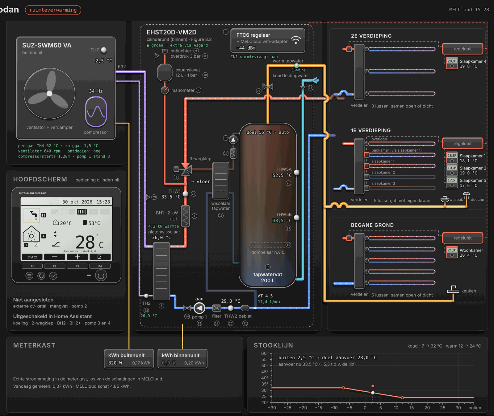
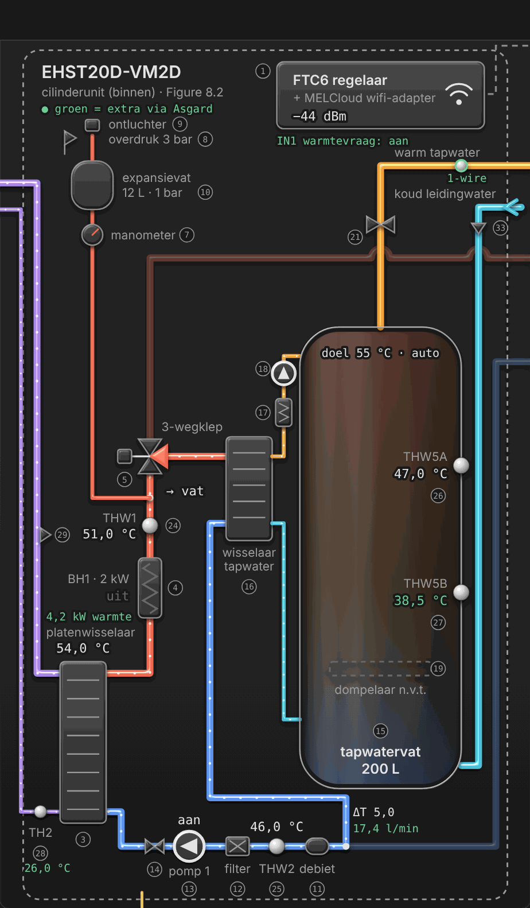
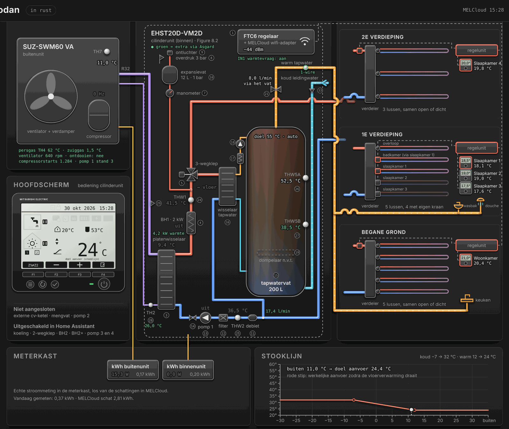
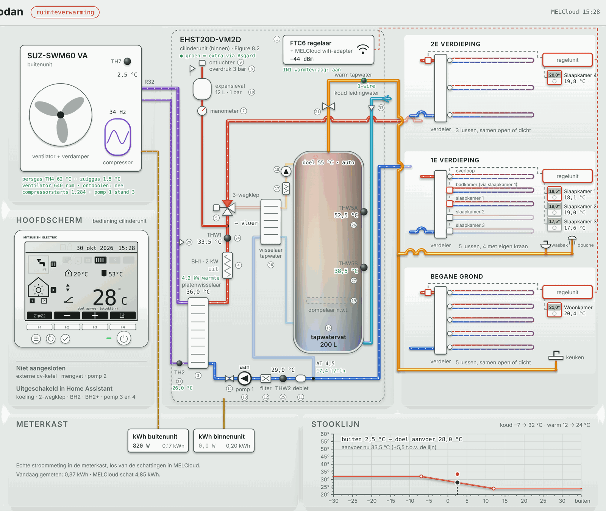

# Ontwerp: cilinderunit volgens de servicehandleiding

Dit is een **ontwerp** op een aparte branch. Het is nog niet bedoeld om te mergen naar `main`.

De cilinderunit is opnieuw getekend volgens *Figure 8.2* (Water system diagram, split model) uit de
servicehandleiding OCH714A van de EHST20D-VM2D. De nummers in het schema zijn de nummers uit Figure 8.2
en *Table 4.1* (Part names and functions).

## Wat er verandert ten opzichte van 1.8.5

- **Geen spiraal in het vat.** Het vat (15) wordt opgewarmd via een aparte platenwisselaar
  water-water (16). De sanitaire pomp (18) pompt water van onderin het vat via de kalkvanger (17)
  door die wisselaar en terug bovenin het vat.
- **Primair circuit zoals in Figure 8.2:**
  - koudemiddel naar platenwisselaar 3, met TH2 (28) en drukvoeler (29);
  - aanvoer via booster heater 4 en THW1 (24) naar 3-wegklep 5;
  - retour via debietmeter 11, THW2 (25), filter 12, pomp 1 (13) en afsluiter 14.
- **Veiligheidsgroep:** expansievat 10 (12 L, 1 bar), manometer 7, ontluchter 9 en overdrukventiel
  8 (3 bar).
- **Tapwater:**
  - overdrukventiel 21 (10 bar) en terugslagklep 33;
  - tappunten keuken (begane grond), wasbak en douche (1e verdieping);
  - tijdens het tappen lichten alle drie de tappunten op. Welke kraan open staat is niet te meten.
- **Hoofdscherm van de bediening** (servicehandleiding 9-1, *Main screen*), op de plek van de zone
  "Niet aangesloten". Die onderdelen staan nu als één regel onderaan die zone.
- **Groene waarden** zijn extra informatie die de Asgard (CN105) kan leveren. In dit ontwerp zijn
  het voorbeeldwaarden.

## Tappen en pompen

Tijdens het tappen draait er geen pomp. De waterleidingdruk duwt koud water onderin het vat, en
dat duwt het warme water bovenuit naar de kraan. Pas als het vat daardoor genoeg afkoelt, gaat de
warmtepomp het vat opwarmen; dan draaien pomp 1 en de sanitaire pomp 18.

## Asgard (esphome-ecodan-hp) als vervanger van de MELCloud-adapter op CN105

Bron: [gekkekoe/esphome-ecodan-hp](https://github.com/gekkekoe/esphome-ecodan-hp), map `confs/` en
`protocol.md`. De Asgard leest de FTC6 direct uit, binnen seconden in plaats van met de vertraging
van MELCloud.

| ESPHome-sensor | Betekenis | Plek in het schema |
|---|---|---|
| `dhw_temp` | THW5B (onder in het vat) | THW5B |
| `dhw_secondary_temp` | THW5A (boven in het vat) | THW5A |
| `hp_feed_temp`, `hp_return_temp` | THW1 en THW2 | THW1 en THW2 |
| `hp_refrigerant_temp` | TH2, vloeibaar koudemiddel | TH2 (28) |
| `hp_refrigerant_condensing_temp` | condensatietemperatuur | platenwisselaar 3 |
| `flow_rate` | debiet primair circuit (l/min) | debietmeter 11 |
| `computed_output_power`, `computed_cop` | realtime warmtevermogen en COP | platenwisselaar 3, kerncijfers |
| `status_in1_request` | warmtevraag van de regelunit (IN1) | FTC6, warmtevraagsignaal |
| `status_defrost` | ontdooien | buitenunit, hoofdscherm |
| `status_water_pump`, `pump_speed`, `pump_feedback` | pomp 1 en zijn stand | pomp 1 (13) |
| `status_three_way_valve` | 3-wegklep | 3-wegklep 5 |
| `status_booster`, `status_immersion` | booster heater, dompelaar | BH1 (4), dompelaar 19 |
| `z1_flow_temp_target` | aanvoerdoel van de FTC6 | stooklijn, hoofdscherm |
| `dhw_flow_temp_target`, `dhw_flow_temp_drop`, `legionella_prevention_temp` | tapwaterdoel, hysterese, legionella | vat, hoofdscherm |
| `discharge_temp`, `ou_suction_pipe_temp`, `fan_speed`, `compressor_starts`, … | buitenunit (servicecodes) | onder de buitenunit |
| DS18B20 (1-wire, max. 6) | eigen voelers | voorstel: op de warmwaterleiding, zodat tappen direct te zien is |

Kanttekeningen:

- De servicecodes voor de buitenunit (persgas, ventilator, compressorstarts) werken volgens de
  documentatie niet op alle SUZ-buitenunits.
- Blijft de MELCloud-adapter via de proxypoort van de Asgard aangesloten, dan zijn die extra
  buitenunitwaarden niet beschikbaar: de Asgard luistert dan alleen mee.
